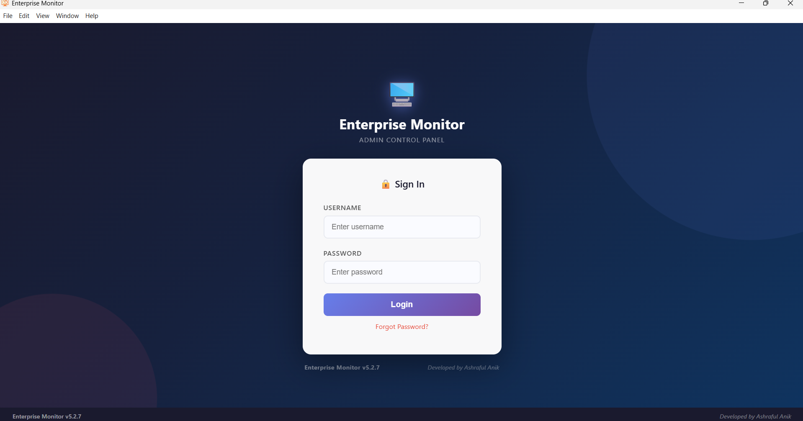
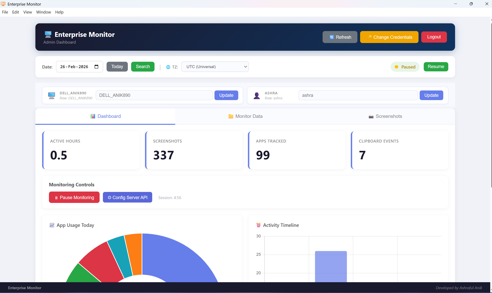
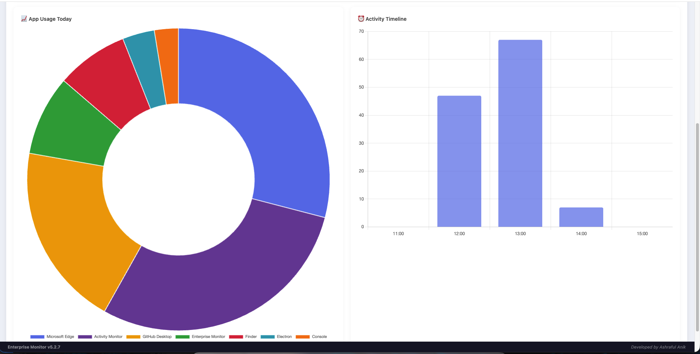
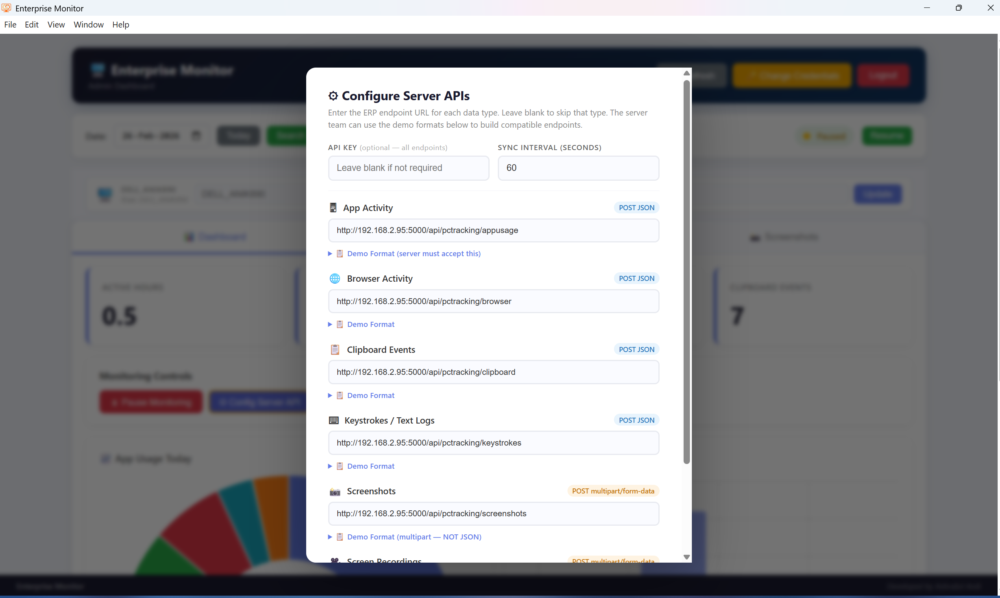

# Octopus
## Business Presentation Documentation

## 1. Executive Summary

Octopus is a cross-platform enterprise monitoring and productivity intelligence solution designed for organizations that need visibility into employee digital activity across Windows and macOS environments. The platform combines a secure desktop client, real-time monitoring, centralized configuration, and data synchronization to give business teams situational awareness across their workforce.

Built as a production-oriented desktop application, Octopus is designed to support enterprise operations such as:
- workforce productivity reporting
- application and web activity monitoring
- endpoint visibility for compliance and governance
- operational analytics for digital work patterns
- secure administration and centralized control

The system is implemented using a master/child architecture with an Electron desktop frontend and Python-based backend services, with SQLite for durable local storage and ERP/API integration for data synchronization.

---

## 2. Business Context and Need

Modern organizations depend on digital workflows, remote operations, and distributed teams. This creates a need for clear observability into how employees use business devices, how systems are being used, and whether digital operations align with organizational policy.

Key business drivers include:
- operational visibility across distributed teams
- productivity analysis and resource planning
- risk reduction through policy compliance monitoring
- accountability for digital work behavior
- centralized management of endpoint activity

Octopus addresses this need by giving enterprises a unified monitoring layer that delivers dashboard-style visibility while maintaining security, role-based control, and configurable policy enforcement.

---

## 3. Product Value Proposition

Octopus enables organizations to transform endpoint activity data into practical business intelligence.

### Core value
- Real-time visibility into employee activity across workstations
- Cross-platform support for Windows and macOS
- Secure authentication and centralized administration
- Built-in data retention, sync, and recovery flow
- Scalable architecture suitable for enterprise deployment

### Why it matters to business leaders
- Improves managerial understanding of workflow patterns
- Supports productivity optimization and workforce planning
- Helps enforce policy, compliance, and risk-handling standards
- Reduces uncertainty around remote employee activity and system use
- Provides a foundation for digital governance across endpoints

---

## 4. Product Overview

Octopus is an enterprise monitoring platform that combines desktop endpoint data collection with admin-friendly reporting and configuration capabilities.

### Product features
- login and user administration
- dashboard analytics for key activity metrics
- monitoring of application usage, browser activity, clipboard activity, keystrokes, screenshots, and recordings
- configurable API / ERP synchronization
- environment and device status controls
- multi-platform support for Windows and macOS

### Product positioning
Octopus is positioned as a professional enterprise monitoring and oversight solution for organizations that require visibility, control, and governance across distributed workstations.

---

## 5. Solution Architecture

The project follows a layered architecture intentionally designed for reliability, cross-platform compatibility, and operational control.

### Architecture summary
1. Frontend layer
   - Electron desktop application provides the user interface and admin dashboard
   - Cross-platform desktop experience for Windows and macOS

2. Application layer
   - Python backend services handle collection, processing, and synchronization logic
   - Master/child process model improves stability and task separation

3. Data layer
   - SQLite used for local ingest, state tracking, and durable storage
   - Local control outbox patterns help ensure data integrity and sync consistency

4. Integration layer
   - ERP/API endpoints enable centralized reporting and remote configuration
   - Configurable server modes support enterprise deployment flexibility

### Architectural benefit
This design balances enterprise-grade control with operational resilience. It allows the product to run on endpoint devices while preserving centralized oversight and improving data integrity.

---

## 6. Business Capabilities and Features

### 6.1 Dashboard Visibility
The platform includes a dashboard that provides operational insight into:
- active hours
- tracked application use
- screenshot collection
- clipboard events
- browser activity
- system and device status

### 6.2 Monitoring Data Collection
Monitoring includes:
- app activity capture
- browser history and URL tracking
- clipboard actions
- keystroke logging
- screenshot snapshots
- screen recordings

### 6.3 Centralized API Configuration
The product supports centralized configuration for enterprise endpoints, allowing operational teams to manage the connection between client devices and server-side systems.

### 6.4 Security and Identity Controls
The system includes:
- credential-protected access
- secure password handling
- JWT-based authentication patterns
- encrypted or protected local storage strategy
- permission-based operating system controls

---

## 7. Screenshots and Product Experience

The system is designed with an enterprise UI and dashboards that deliver a polished operational experience.

These visuals suggest a product intended for professional teams that need a clean, monitorable, enterprise-class admin experience.

---

## 8. Target Audience

Octopus is best suited for:
- enterprise IT departments
- digital governance teams
- workforce management organizations
- compliance-focused organizations
- remote or hybrid workforce monitoring operations

### Ideal customer scenarios
- organizations needing endpoint visibility across distributed teams
- leadership teams wanting operational productivity signals
- departments that need oversight of digital activity according to company policy
- organizations running mixed Windows and macOS environments

---

## 9. Business Use Cases

### Use case 1: Workforce Oversight
Managers gain visibility into employee engagement patterns and application usage across workstations, enabling better operational decision-making.

### Use case 2: Compliance and Governance
Organizations can monitor system behavior in alignment with internal policies and regulatory procedures, improving accountability and governance.

### Use case 3: Remote Team Management
For hybrid and distributed teams, the product offers a centralized window into workforce activity across endpoint devices.

### Use case 4: Incident and Risk Review
Teams can review screenshots, logs, and activity timelines to support investigations, audits, and operational awareness.

---

## 10. Competitive Differentiation

Octopus differentiates itself through a combination of:
- cross-platform support for Windows and macOS
- desktop-first enterprise UX
- real-time dashboard analytics
- local durable state management and sync reliability
- automation-ready API integration
- configurable deployment modes for enterprise environments

The solution is designed not only as a monitoring tool, but as an operational intelligence platform with a dependable backend and enterprise-ready integration model.

---

## 11. Security and Compliance Considerations

Because this product involves monitoring of employee activity, trust, data governance, and regulatory compliance are critical.

The project already reflects several important design principles:
- authenticated access
- secure credential handling
- system-level permission management
- local retention and lifecycle controls
- API-based synchronization with centralized configuration
- durable local storage and sync reliability

For enterprise deployment, the product should be positioned as a policy-driven monitoring platform operating only in authorized business environments and under compliance review.

---

## 12. Technical Strengths

The repository reveals a mature technical foundation:
- Electron-based desktop interface for a modern admin experience
- Python backend for cross-platform monitoring logic
- SQLite for durable local tracking and retention
- FFmpeg-based multimedia capture for video and screen recording
- hardware-aware video capture optimization
- multi-platform compatibility for both Windows and macOS
- integration-ready server sync model

These qualities demonstrate strong engineering depth and enterprise-readiness.

---

## 13. Business Impact and ROI

Octopus creates measurable value for enterprises by:
- improving visibility into operational routines
- supporting productivity benchmarking
- strengthening governance and internal compliance controls
- reducing uncertainty related to remote workforce performance
- improving decision-making with analytics-based operational insight

### Example ROI drivers
- better workforce planning
- reduced time spent on manual monitoring
- stronger policy enforcement
- lower operational ambiguity in distributed teams
- improved digital oversight across workstations

---

## 14. Risks and Considerations

Although the product has clear business value, several considerations must be addressed for enterprise success:
- privacy and legal compliance requirements
- employee consent and policy transparency
- configuration and permissions management across devices
- secure synchronization and data retention controls
- organizational change management for adoption

A successful enterprise deployment requires governance, transparency, and clearly documented monitoring scope.

---

## 15. Roadmap and Future Potential

The current project already includes advanced features such as monitoring dashboards, local storage durability, API configuration, and hardware-aware recording improvements. Future expansion opportunities include:
- deeper analytics and KPI dashboards
- AI-driven productivity and anomaly detection
- expanded reporting and export capabilities
- multi-region enterprise deployment support
- stronger role-based access and audit log controls
- integration with broader enterprise systems and compliance workflows

---

## 16. Closing Summary

Octopus is a strong example of a business-oriented, cross-platform enterprise monitoring solution. It combines operational visibility, secure architecture, and modern desktop application design into a product capable of supporting digital governance, productivity oversight, and large-scale enterprise monitoring scenarios.

The platform represents a compelling blend of technical depth and business utility, making it well-suited for organizations seeking enterprise-level endpoint intelligence and operational awareness.

---

## 17. Executive Closing Statement

Octopus provides a practical bridge between operational oversight and enterprise decision-making. In a digital-first business environment, leadership needs more than generic productivity metrics—they need a dependable, secure, cross-platform system for understanding how work is happening across the organization. Octopus is built to meet that need.

---

## 18. Suggested Presentation Title Slide

### Octopus
#### Enterprise Monitoring and Workforce Visibility Platform

Prepared for business stakeholders, enterprise leadership, and operational decision-makers.

---

## 19. Speaker Notes

If presenting this project to a business audience, emphasize the following points:
- this is a production-oriented enterprise monitoring platform
- it is built for cross-platform environments
- it gives teams visibility into digital activity at scale
- it supports governance, compliance, and operational oversight
- it combines a strong technical foundation with meaningful business value

Focus on the business problem solved, the operational impact, and the product's enterprise readiness.

---

## 20. Presentation Status

This documentation is designed to support a business presentation for the Octopus project and can be adapted for:
- investor discussions
- client presentations
- internal strategy reviews
- product demo storytelling
- executive briefing decks

This presentation is intentionally framed in a business context while staying aligned with the technical realities of the project repository.
